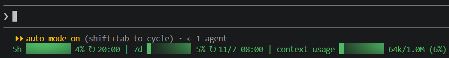
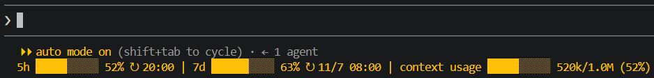
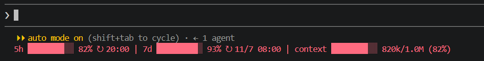

# oziji-claude-plugins

English | [日本語](./README.ja.md)

A collection of Claude Code mods (plugins). A mod changes the interface or behavior of Claude Code itself, such as a status display or a slash command.

This repository is a Claude Code marketplace. Install a mod with `/plugin install`.

## Mods

| Mod | Description |
| --- | --- |
| `usage-status` | Always shows the 5-hour and 1-week usage limits and the session token usage as gauges below the mode line. A gauge turns yellow at 50% and red at 80%. |
| `compact-assist` | Shows a cue and a button when context usage reaches 70%. The button writes a memo, then runs compact. |
| `notify-on-wait` | Plays a 0.3-second sound when a permission prompt or a question from the model appears. Blinks the band above the prompt and a pane until you answer. |

## Install

Prerequisite: Claude Code is installed and the `claude` command works.

Enter this command at the Claude Code prompt:

```
/plugin install usage-status --marketplace tomoyankun/oziji-claude-plugins
```

1. The first time, Claude Code shows `Add marketplace?`. Select `y`.
2. Select a scope.
   - **user**: The mod is active in every session, in any repository.
   - **project**: Claude Code records the setting in `.claude/settings.json` of the target repository. Use this to share the mod with a team.
3. After the install, the mod is active in the same session.

To install from a source other than GitHub, give a git URL or a local folder path in place of `tomoyankun/oziji-claude-plugins`.

### Share with a team

Write this in `.claude/settings.json` of the target repository. Every member who opens and trusts the repository is prompted to add the marketplace and enable the mod.

```json
{
  "extraKnownMarketplaces": {
    "oziji-claude-plugins": {
      "source": { "source": "github", "repo": "tomoyankun/oziji-claude-plugins" }
    }
  },
  "enabledPlugins": {
    "usage-status@oziji-claude-plugins": true
  }
}
```

### Update

1. Run `claude plugin marketplace update oziji-claude-plugins`.
2. Run `claude plugin update usage-status@oziji-claude-plugins`.
3. Run `/reload-plugins`.

## usage-status

The gauge position depends on the environment.

- Terminal: One line below the mode line. The color changes with the usage rate.

  Below 50% (green):

  

  50% or more (yellow):

  

  80% or more (red):

  

- Desktop app: The "Status" pane on the right side lists the gauges vertically.

  ```
  5h ████░░░░░░ 42% ↻ 18:30
  7d ██████░░░░ 63% ↻ 11/8 09:00
  context ██░░░░░░░░ 45k/200k (23%)
  ```

Each gauge means the following.

- `5h`: Usage rate of the 5-hour window and its reset time.
- `7d`: Usage rate of the 1-week window and its reset date and time.
- `context`: Session token usage / limit, and the usage rate.

The 5-hour and 1-week values appear only when you use a subscription.

- The 5-hour and 1-week gauges carry the reset time (`↻`).
- The gauges do not appear in the pane of a tmux teammate.
- In the desktop app, the "Status" pane shows the gauges in addition to the line below the mode line. The pane opens automatically when the desktop app connects (0.9.0 and later).
  - `/usage-status pane`: Opens the pane. In the terminal, the pane also opens from the next session on.
  - `/usage-status pane off`: Closes the pane. The desktop app no longer opens it.
- `/usage-status` turns the display on or off. With no argument, it toggles. Give `on` or `off` to set the state. The setting is saved in `~/.claude/usage-status.json` and persists across restarts.
- Known limitation: The gauges also appear while a survey or an agent transcript is shown. The props of `PromptHint` carry no information about these two states.

## compact-assist

As context grows, the accuracy of the AI can drop. `compact-assist` tells you when to summarize (`/compact`).

- Usage of 70% or more: Shows a red "context N%:" and a button, "メモを残して /compact を実行" (save a memo and run /compact).
- Button: Makes the model write `~/.claude/compact-memo.md`. Right after the turn that writes the memo, the mod runs `/compact` automatically. The summary instruction includes a sentence that tells the model to read the memo again.
- `/compact-memo`: Only makes the model write the memo. It does not run compact. The memo holds decisions, unfinished tasks, the next action, and methods that failed. An existing file is overwritten.

## notify-on-wait

Tells you when Claude Code waits for your action.

- Targets: A permission prompt, a question from the model, and a permission prompt or question from a teammate.
- Sound: Plays the bundled WAV (0.3 seconds) once. A permission prompt uses 880 Hz. A question uses 660 Hz.
- Blink: The band above the prompt and the "入力待ち" (waiting for input) pane on the right blink until you answer.
- The mod does not stack sounds for the same wait.

Sound playback uses this command on each OS.

| OS | Command |
| --- | --- |
| mac | `afplay` |
| Linux | `paplay`. If it fails, `aplay` |
| WSL | `System.Media.SoundPlayer` through `powershell.exe` |

Limitations:

- The mod was tested only on WSL (tmux and the VS Code terminal). It is untested on mac and Linux.
- The pane opens only when the terminal is 110 columns wide or more. When a tmux split is too narrow, only the sound plays.
- While a question dialog is shown, the band above the prompt is hidden.
- The mod cannot detect the answer to a teammate's wait. The blink stops after 30 seconds.
- In an environment without a playback command, no sound plays.

## License

[MIT License](./LICENSE).
