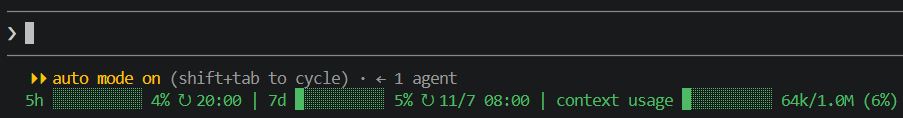
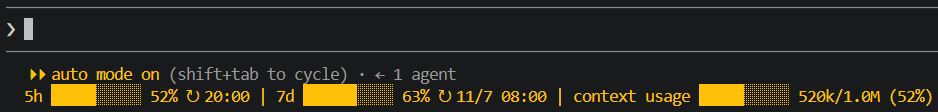
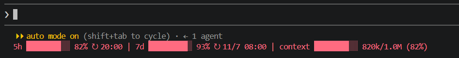

# usage-status

[English](./README.md) | 日本語

5時間枠と1週間枠の使用量制限、およびセッションのトークン使用量を、モード行の下にゲージで常時表示します。50%以上は黄、80%以上は赤で表示します。

## インストール

```
/plugin install usage-status --marketplace tomoyankun/oziji-claude-plugins
```

スコープの選択、チームでの共有、更新の手順は、[ルートの README](../../README.ja.md) を参照してください。

## 表示

ゲージの位置は、環境によって異なります。

- ターミナル: モード行の下の1行です。使用率に応じて色が変わります。

  50%未満(緑):

  

  50%以上(黄):

  

  80%以上(赤):

  

- デスクトップアプリ: 右側の「ステータス」ペインに、ゲージを縦に並べます。

  ```
  5h ████░░░░░░ 42% ↻ 18:30
  7d ██████░░░░ 63% ↻ 11/8 09:00
  context ██░░░░░░░░ 45k/200k (23%)
  ```

各ゲージの意味は、次のとおりです。

- `5h`: 5時間枠の使用率と、リセット時刻です。
- `7d`: 1週間枠の使用率と、リセットの日時です。
- `context`: セッションのトークン使用量 / 上限と、使用率です。

5時間枠と1週間枠の値は、サブスクリプションを使っているときだけ表示されます。この2つのゲージには、リセット時刻(`↻`)が付きます。

## コマンド

| コマンド | 動作 |
| --- | --- |
| `/usage-status` | 表示のオンとオフを切り替える |
| `/usage-status on` | 表示をオンにする |
| `/usage-status off` | 表示をオフにする |
| `/usage-status pane` | 「ステータス」ペインを開く。ターミナルでは、次のセッションからもペインを開く |
| `/usage-status pane off` | ペインを閉じる。デスクトップアプリも、ペインを開かなくなる |

表示の設定は `~/.claude/usage-status.json` に保存され、再起動後も保たれます。

## ペイン

デスクトップアプリでは、モード行の下の1行に加えて、「ステータス」ペインにもゲージを表示します。デスクトップアプリが接続すると、ペインが自動で開きます(0.9.0 以降)。

## 制限事項

- tmux のチームメイトのペインには、ゲージが表示されません。
- アンケートやエージェントのトランスクリプトの表示中も、ゲージが表示されます。`PromptHint` の props に、この2つの状態を示す情報がないためです。
