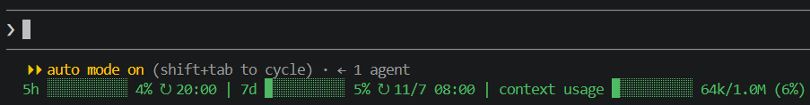
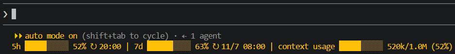
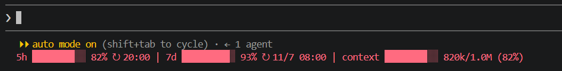

# usage-status

English | [日本語](./README.ja.md)

Always shows the 5-hour and 1-week usage limits and the session token usage as gauges below the mode line. A gauge turns yellow at 50% and red at 80%.

## Install

```
/plugin install usage-status --marketplace tomoyankun/oziji-claude-plugins
```

See the [root README](../../README.md#install) for the scope options, team sharing, and update steps.

## Display

The gauge position depends on the environment.

- Terminal: One line below the mode line. The color changes with the usage rate.

  Below 50% (green):

  

  50% or more (yellow):

  

  80% or more (red):

  

- Desktop app: The "Status" pane on the right side lists the gauges vertically.

  ```
  5h ████░░░░░░ 42% ↻ 18:30
  7d ██████░░░░ 63% ↻ 11/8 09:00
  context ██░░░░░░░░ 45k/200k (23%)
  ```

Each gauge means the following.

- `5h`: Usage rate of the 5-hour window and its reset time.
- `7d`: Usage rate of the 1-week window and its reset date and time.
- `context`: Session token usage / limit, and the usage rate.

The 5-hour and 1-week values appear only when you use a subscription. These gauges carry the reset time (`↻`).

## Commands

| Command | Action |
| --- | --- |
| `/usage-status` | Toggles the display on or off. |
| `/usage-status on` | Turns the display on. |
| `/usage-status off` | Turns the display off. |
| `/usage-status pane` | Opens the "Status" pane. In the terminal, the pane also opens from the next session on. |
| `/usage-status pane off` | Closes the pane. The desktop app no longer opens it. |

The display setting is saved in `~/.claude/usage-status.json` and persists across restarts.

## Pane

In the desktop app, the "Status" pane shows the gauges in addition to the line below the mode line. The pane opens automatically when the desktop app connects (0.9.0 and later).

## Limitations

- The gauges do not appear in the pane of a tmux teammate.
- The gauges also appear while a survey or an agent transcript is shown. The props of `PromptHint` carry no information about these two states.
